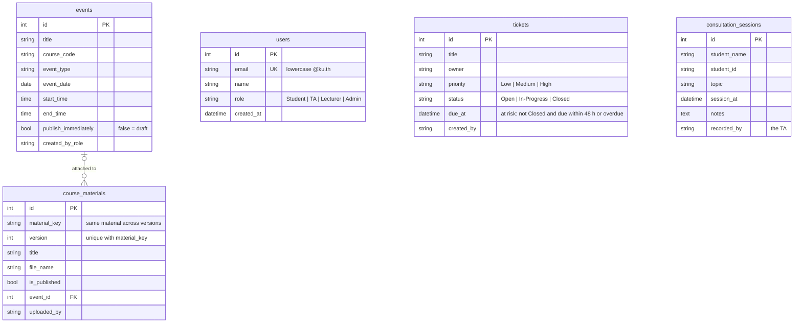

# GuildBoard Database

PostgreSQL schema built by Alembic migration `0001_initial_schema`.
Traceability: users (SRS-3, SRS-8, SRS-11), events (SRS-1 to SRS-5),
tickets (US-3, US-4, SRS-6, SRS-7), consultation_sessions (US-9, SRS-9, SRS-10),
course_materials (US-1, US-2, SRS-1).

People are stored as text (the signed-in user's id or name), matching the
session model, so a ticket owner or consulted student does not need an account.

